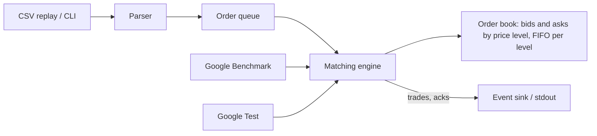

# Plan 4 (optional): Limit Order Matching Engine in C++

## Status
Optional and last. The slate found the C++ postings (P12, P13) are low-latency trading roles wanting 3 to 6+ years of production C++, one NYC-based and one with an unclear pay unit. A portfolio project will not close that gap. The slate suggests a second .NET/AWS + AI project (for example a .NET 8 microservice with SQS/SNS, OpenTelemetry, and a tool-calling agent) may be a better use of the time. Build this only if he wants C++ reps or data-structures practice. Keep it small.

## Goal
A single-threaded price-time priority limit order book and matching engine, with unit tests and published benchmark numbers.

Job keywords it proves: C++20, STL, move semantics, data structures, CMake, Google Test, Google Benchmark, (stretch) lock-free queue, Linux perf.

## Scope
MVP:
- Limit and market orders, buy and sell, partial fills, cancel, modify (cancel/replace).
- Price-time priority; trade reports emitted through a callback or event queue.
- Command-line driver that replays orders from a CSV file.
- Google Test coverage of matching rules and edge cases.
- Google Benchmark for add, cancel, and match throughput and latency percentiles.

Stretch:
- Single-producer single-consumer lock-free queue between input thread and engine thread.
- Memory pool / object reuse and a before and after benchmark.
- Multiple symbols.
- Sanitizers (ASan, UBSan, TSan) in CI; perf flamegraph in README.

## Parameters
- Repo: pburt-dev/cpp-matching-engine (/include, /src, /tests, /bench, /tools, /data)
- Stack: C++20, CMake 3.2x+, GCC or Clang on Linux, Google Test, Google Benchmark (fetched with CMake FetchContent or vcpkg), clang-format, clang-tidy.

Architecture:

Data model:
- Order: id, side, type, price (integer ticks), qty, remaining, timestamp/sequence
- PriceLevel: price, FIFO list of orders, total qty
- OrderBook: bids (descending), asks (ascending), id -> order location map for O(1) cancel
- Trade: buy_id, sell_id, price, qty, sequence

Interface surface (library API, no network):
- submit(order) -> ack and list of trades
- cancel(order_id) -> ok / not found
- replace(order_id, new_price, new_qty)
- best_bid(), best_ask(), depth(n)
- CLI: matching_engine --input orders.csv --output trades.csv

## Milestones (about 1 week each)
1. Setup: CMake project, Google Test and Benchmark wired, CI building with GCC and Clang, clang-format check.
2. Order book: TODO data structures choice (write an ADR comparing map vs array of levels), add and cancel, tests.
3. Matching: TODO limit and market matching, partial fills, price-time priority tests, edge cases (empty book, self-cross, zero qty).
4. Replay + benchmarks: TODO CSV replay CLI, synthetic order generator, benchmarks with throughput and p50/p99 latency.
5. Polish: README with benchmark table and machine specs, sanitizers in CI, resume bullet, v1.0.0.

## Acceptance criteria / definition of done
- All matching rules covered by tests; no sanitizer errors.
- Benchmarks reproducible with one command and results recorded with CPU, compiler, and flags.
- Cancel is O(1) or the README explains the chosen complexity.
- Builds warning-free with -Wall -Wextra -Werror.

## Testing and CI
- Google Test unit tests, optional property-style randomized tests comparing against a simple reference implementation.
- CI: GitHub Actions matrix (GCC, Clang), Debug with sanitizers, Release with benchmarks (smoke only, real numbers recorded locally since CI runners are noisy), clang-tidy.

## Deployment target
None needed; it is a library and CLI. Release binaries attached to a GitHub release. If a demo host is wanted, no AWS cost is justified for this one.

## README and demo for recruiters
- Pitch, short terminal recording (asciinema) of replay output, benchmark table, design notes on data structures and complexity, "what I would do next" (lock-free queue, multi-symbol).

## Resume bullet template (fill with real numbers)
**Limit Order Matching Engine (personal project)** | C++20, CMake, Google Test
- Implemented a price-time priority matching engine in C++20 with Google Test coverage of partial fills and cancels, benchmarking [N] orders/sec with Google Benchmark.

## Interview Coach practice
Drills and questions: [Interview Coach chat](grokbot://app/v1/agent?id=98540b55-e842-4e85-83da-c2392987f3b4)
Topics: RAII, move semantics, smart pointers, cache locality, std::map vs flat structures, big-O of book operations, memory ordering basics, why benchmarks lie.
